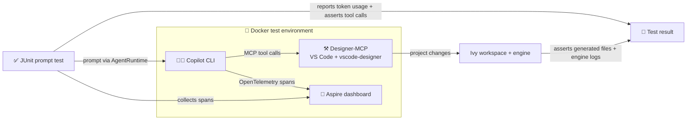

# AI Tests

Tests the native tools and skills of the vscode-designer.
The focus is on asserting the effectiveness of a real-world prompt.

## 🐳️ Docker

We use test-containers to run the complete environment in Docker.

- **Designer-MCP**: runs VSCode and the vscode-designer extension with an MCP enabled.
- **Copilot**: runs copilot CLI with the designer MCP enabled.
- **Aspire**: runs the opentelemetry compatible Aspire dashboard to trace the copilot execution. The collected spans are asserted to verify copilot behavior.

### ♻️ Validation flow

The prompt tests verify both what the agent reports and what it actually does:



The tests report token usage from Aspire spans, assert tool calls where applicable, and validate generated files in the Ivy workspace and engine logs from the Designer-managed Ivy engine.

## 🏃️ Running tests

1. Run the PNPM build to craft the extension.
   ```bash
   # see .github/workflows/ai.yml
   pnpm install
   pnpm run build:production
   pnpm run package
   ```
2. Set the environment variables (see TestEnv section above).  
   Note that `JAVA_HOME` works with Temurin:25 (but not with OpenJDK).

   ```bash
   # linux example
   export JAVA_HOME=/usr/lib/jvm/temurin-25-jdk-amd64/
   export HOST_UID=$(id -u)
   export HOST_GID=$(id -g)
   export COPILOT_TOKEN=github_pat_xyz...
   ```

3. Run the tests in Maven

   ```bash
   # maven
   mvn clean verify

   # or in vscode
   code ai-designer.code-workspace
   # 1. Open File: CopilotIntegrationTest.java
   # 2. Command: `Java: Run Tests`
   ```

## 🧑‍💻️ Developing Tests

- Work on a git branch with prefix `ai.`, since these branches will automatically run the AI pipeline (and be excluded from other vscode centric builds).

- For faster local test runs, enable Testcontainers reuse:
  1.  **Project setting:** `TESTCONTAINERS_REUSE_ENABLE` env defaults to `true` locally and `false` in CI.
  2.  **User setting:** Enable reuse in `~/.testcontainers.properties`:
      ```bash
      echo "testcontainers.reuse.enable=true" >> ~/.testcontainers.properties
      ```

## ❤️‍🩹 Troubleshooting

🤔 How to use Aspire to identify prompt that don't work at all or are in-effective?

> 1. Run a prompt test locally.
> 2. Get the Aspire Dashboard URI from the console log
>
> ```bash
>   Aspire dashboard bound: http://localhost:32770/api/telemetry
> ```
>
> 2. Visit the 'Traces' view (e.g. http://localhost:32770/traces )
> 3. Click on the prompt that reflects your test
> 4. Review the tools invoked
> 5. Were the tools used that we expected, are the arguments ok?

🤔 Where to lease a valid Github Copilot token?

> 1. Lease a Fine Grained token on Github: [lease-token](https://github.com/settings/personal-access-tokens/new)
> 2. Scope
>
> ```
> RepositoryAccess = public
> Permissions = Copilot Chat
> ```
>
> 3. use it as (COPILOT_TOKEN) env.

🤔 How to configure vscode for aitest development?

> 1. Use a dedicated profile for "java-only" development. Not containing the vscode-designer extension.
> 2. Install java-extension pack. See [extensions](./.vscode/extensions.json)
