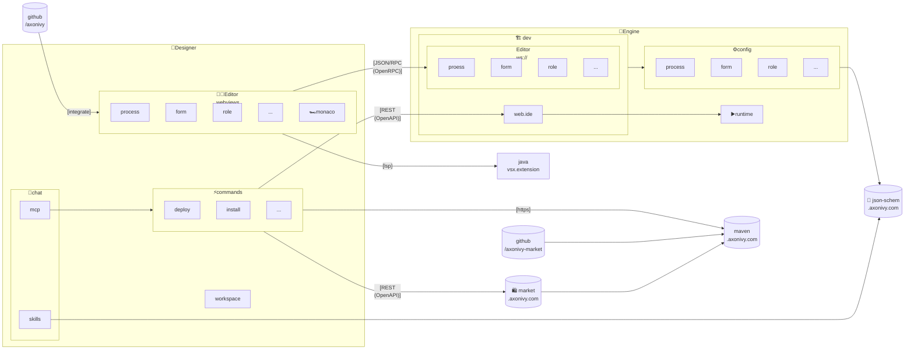
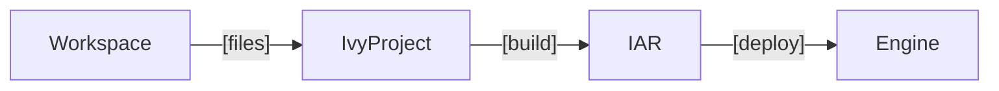

# VSCode Designer

## Integration

Editor-WS capabilities
- IO
- Validate
- Meta

References
- [Editor Repos](https://github.com/axonivy?q=editor&type=all&language=&sort=)
- [Schemas](https://json-schema.axonivy.com)
- [Market](https://market.axonivy.com)

Project Lifecycle

